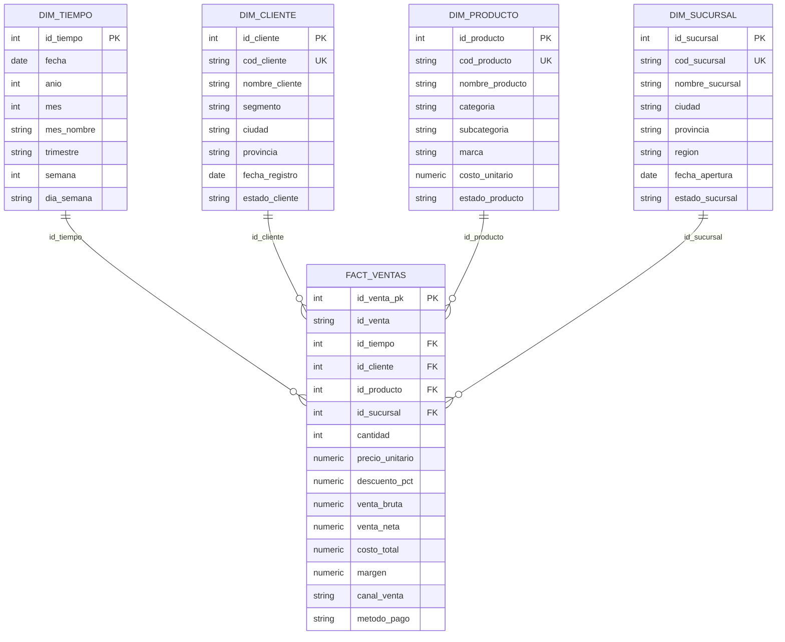

# Esquema estrella — Data Warehouse

Relaciones: `fact_ventas` se une a cada dimensión por su surrogate key (`id_tiempo`, `id_cliente`, `id_producto`, `id_sucursal`). `dim_provincia_mapa` es auxiliar para el dashboard.